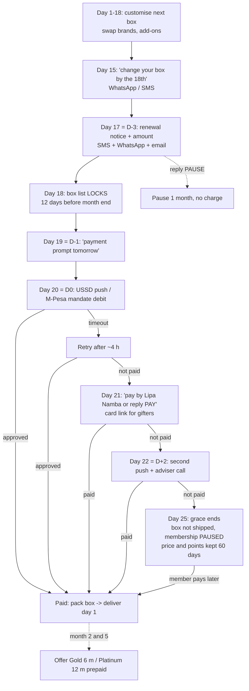

# R5 — Recurring payments (feeds 3.4, 3.8, 4.1)

Checked 9 Nov 2026. Every fact below carries its source, a short verbatim quote and the date checked. Where a page could not be opened, the entry says **"search snippet, page not opened"**. Where nothing was found, it says **"not found"** and the item is listed under Open items. Anything labelled **Afya design** is our proposal, not a fact.

## In plain language

1. **Fully automatic monthly collection is not yet a normal, available service in Tanzania.** The Bank of Tanzania's own 2025 report lists "standing orders for recurring payments … and subscriptions" as a future opportunity, not as something that exists.
2. **M-Pesa (Vodacom) appears to have a direct-debit "mandate" feature in its developer API.** We could not open Vodacom's portal. Whether a store like Afya can actually get it needs a call to Vodacom.
3. **What does work today on every network is the "push" request.** On renewal day, Afya sends a payment request to the member's phone, and the member approves it with their PIN. Yas (Mixx, formerly Tigo Pesa), Airtel Money and HaloPesa all support it through aggregators.
4. **One aggregator connection (AzamPay, Selcom, ClickPesa or Pesapal) reaches all the wallets.** That is simpler than four separate operator contracts.
5. **Cost:** the showroom's AzamPay figures (1% or 3% for mobile money, 3.5% + VAT for cards) **could not be checked**, because the AzamPay site was unreachable. Until we have a written rate card, budget **about TSh 2,700 for every TSh 100,000 collected** (estimate; see the fee line).
6. **For the member:** a "customise your box" reminder, then the box list locks 12 days before month end. Reminders follow 3 days and 1 day before payment day. On payment day a PIN prompt arrives on the phone, with one more try 2 days later.
7. **If the payment fails:** the box waits up to 5 days. After that the membership is paused, not cancelled, and nothing is packed until it is paid.
8. **The best defence against members leaving is the 6-month (Gold) or 12-month (Platinum) plan paid up front.** One payment replaces 6 or 12 monthly approvals.
9. **Diaspora relatives can pay by card.** Pesapal publishes a recurring card feature (Visa and Mastercard). AzamPay, Selcom, ClickPesa and DPO also take cards. No card fee could be verified.
10. **Still needs calls:** Vodacom (mandate product and fees), Yas, Airtel and Halotel (merchant fees), and AzamPay or one alternative (a signed rate card and settlement time).

---

## 1. Verifying the "already found" item

Brief, Part F R5: *"true standing orders on M-Pesa (M-Pesa Ratiba) exist in Kenya; in Tanzania recurring billing over M-Pesa is done with payment mandates plus a reminder sequence (D-3, D-1, D0, D+2) rather than standing orders."*

| Claim | Verdict | Evidence (checked 9 Nov 2026) |
|---|---|---|
| M-Pesa Ratiba, true standing orders, exists in Kenya | **Confirmed** (search snippet, page not opened) | Safaricom press release, 20 Sep 2024, https://safaricom.co.ke/media-center-landing/press-releases/safaricom-rolls-out-a-standing-order-feature-for-m-pesa-users: "M-PESA Ratiba will allow customers to conveniently schedule their utility and other payments on M-PESA". Access is "on the M-PESA App's Financial Services tab and on USSD through *334# option 9". Press reports say Safaricom "is expected to expand this service to other markets … including Tanzania" (Eastleigh Voice, https://eastleighvoice.co.ke/business/79169/safaricom-rolls-out-standing-order-feature-for-m-pesa-users, search snippet). **No evidence that Ratiba has launched in Tanzania.** |
| Tanzania has no general standing-order / direct-debit rail for recurring payments | **Confirmed** (primary source, opened) | Bank of Tanzania, *National Payment Systems Annual Report 2025* (p. 30), https://www.bot.go.tz/Publications/Regular/Annual%20Report/en/2026060211494565.pdf: "Enhancements such as request-to-pay services and standing orders for recurring payments covering utilities, school fees, insurance premiums, and subscriptions would improve convenience …". The 2024 report, §2.1.7, https://www.bot.go.tz/Publications/Regular/Annual%20Report/sw/2025032515311662.pdf, says: "In 2024, the Bank continued with its efforts towards the introduction of a Direct Debt [sic] within TACH to address the infrastructure gap related to the payment of recurring transactions, such as … television subscriptions, and other merchant payments." The first mention is in the 2022 report, §2.1.9, https://www.bot.go.tz/Publications/Regular/Annual%20Report/en/2024020511594863.pdf: "In 2022, the Bank started the development of a Direct Debit Management System". |
| In Tanzania, recurring billing over M-Pesa uses "payment mandates" | **Partly confirmed: the API feature appears to exist; commercial availability to a retailer is unconfirmed** | Open-source Vodacom Tanzania client *python-pesa* 0.7 (PyPI, opened; source code read), file `pypesa/service_urls.py`: `"https://openapi.m-pesa.com:443/openapi/ipg/v2/vodacomTZN/directDebitCreation/"` and `".../vodacomTZN/directDebitPayment/"`. Its docs (https://kalebu.github.io/python-pesa/docs/direct_debit, search snippet, page not opened) say: "Direct Debits are payments in M-Pesa that are initiated by the Payee alone without any Payer interaction, but permission must first be granted by the Payer" and "The customer is able to view and cancel the Direct Debit mandate from G2 menu accessible via USSD menu or the Smartphone Application." These are third-party clients, not Vodacom documents. The official portal (openapiportal.m-pesa.com) could not be reached. **Founder action.** |
| The reminder sequence D-3, D-1, D0, D+2 | **Not an industry or regulatory standard; it is a design choice** | No operator or regulator source found. The only match is vendor blog content (Kolonell, https://kolonell.com/en/blog/recurring-billing-subscriptions-mpesa-tanzania-2026, search snippet, page not opened): subscriptions depend on "either a pre-approved mandate (where the operator offers it) or on a well-orchestrated reminder-to-pay sequence". Kolonell's own posts contradict each other on whether M-Pesa mandates are live. We keep D-3/D-1/D0/D+2 as the **Afya design** in §5. |

**Corrected wording for the brief / 3.4:** "In Kenya, M-Pesa offers true standing orders (M-Pesa Ratiba, launched Sept 2024). Tanzania has no general standing-order service for mobile money yet; the Bank of Tanzania has been building a direct-debit system since 2022. Vodacom's M-Pesa developer API includes a direct-debit mandate function, but whether merchants can use it is still to be confirmed with Vodacom. Afya therefore plans on a monthly payment request (USSD push) with a reminder sequence. It will switch to a mandate where an operator offers one."

---

## 2. Mobile-money providers (merchant side)

| Provider | Merchant collection products found | Recurring / mandate | Merchant fee | Integration route | Evidence (checked 9 Nov 2026) |
|---|---|---|---|---|---|
| **Vodacom M-Pesa** | *Lipa kwa Simu / Lipa kwa M-Pesa* (merchant "Lipa Number"); C2B single-stage payment API (USSD push) | Direct-debit mandate endpoints exist in the Open API (third-party evidence); **commercial availability not found** | **Not found** | Direct Open API (openapi.m-pesa.com, market `vodacomTZN`), or any aggregator | Vodacom Tanzania PLC *Annual Integrated Report 2025* (opened), https://www.vodacom.co.tz/assets/uploads/Vodacom_Tanzania_PLC_Annual_Integrated_Report_2025_f75bdd1d49.pdf: "more than 470 000 merchants who accept payments via LIPA kwa Simu service in M-Pesa" and "processed payments averaged more than TZS1 trillion per month". python-pesa source: `".../vodacomTZN/c2bPayment/singleStage/"`. Vodacom's merchant and tariff pages returned HTTP 403. |
| **Yas: Mixx by Yas** (formerly Tigo Pesa; Honora Tanzania Mobile Solutions) | *Lipa kwa Simu* merchant payments; USSD push via aggregators | **Not found** | **Not found** (operator "reserves the right to impose … charges") | Aggregator (TemboPlus, Selcom, AzamPay list it); direct API not found | Yas *Lipa kwa Simu Terms and Conditions* (search snippet, page not opened; yas.co.tz blocked), https://www.yas.co.tz/wp-content/uploads/2025/03/LIPA-KWA-SIMU-TERMS-AND-CONDITIONS.pdf: "reserves the right to impose, add or amend charges for payment transactions". TemboPlus docs (search snippet), https://tembo.gitbook.io/tembo/reference/mobile-money-collection, list Mixx by Yas as a USSD-push collection channel. |
| **Airtel Money Tanzania** | Merchant collection API (USSD push, PIN prompt, webhook callback) | **Not found** | **Not found** (blog figures of "1.5–2%" and "1–1.8%" conflict; not used) | Direct via Airtel Africa developer portal, or aggregator | *pyairtel* (PyPI, search snippet), https://pypi.org/project/pyairtel/: "Python client for Airtel Money Tanzania — Collection & Disbursement APIs". Developer portal https://developers.airtel.africa/ could not be reached. www.airtel.co.tz loads only an app shell with no readable content. |
| **HaloPesa (Halotel / Viettel)** | USSD-push collection via aggregators | **Not found** | **Not found** | Aggregator only (no direct API document found) | TemboPlus (search snippet): channel code "TZ-HALOTEL-C2B". AzamPay SDK provider list includes "Halopesa" (see §3). |
| **National layer: TIPS / TANQR "Lipa Namba"** (Bank of Tanzania) | One standard merchant number or QR for all wallets and banks; customer-initiated | No (the customer starts each payment) | Not stated in the guideline | Through Afya's bank or wallet provider | BoT *Customer Experience Guideline for Merchant Payments*, May 2023 (opened), https://www.bot.go.tz/Publications/Acts,%20Regulations,%20Circulars,%20Guidelines/Guidelines/sw/2023062016582894.pdf: "involves the use of a standardized Merchant QR code or number ('Lipa Namba')". BoT NPS Report 2025: merchants "more than doubled to 2.79 million, driven by TANQR Pay Number". |

**Reading:** a monthly PIN-approved push request works on all four wallets today. An automatic debit with no customer action is, at best, an M-Pesa-only API feature that still needs confirming. The Lipa Namba / TANQR number is the fallback: the member pays it themselves if the push fails.

---

## 3. Aggregators active in Tanzania

| Aggregator | Wallets supported | Cards | Recurring / tokenised | Published fees | Settlement time | Evidence (checked 9 Nov 2026) |
|---|---|---|---|---|---|---|
| **AzamPay** (Bakhresa Group) | Airtel, Tigo (Mixx), HaloPesa, AzamPesa, M-Pesa; also bank checkout | Visa / Mastercard (vendor claim) | **Not found** (no recurring or mandate call in the SDK) | **Showroom figure not verified**: azampay.com/pricing and azampay.co.tz were unreachable | **Not found** | AzamPay Node SDK 0.0.5 (npm, opened), README: "provider \| Enum: Airtel \| Tigo \| Halopesa \| Azampesa \| Mpesa". SDK sections: Bank Checkout, MNO Checkout, Disbursement, Name Lookup, Transaction Status, Post Checkout; no recurring. Hosts: `checkout.azampay.co.tz`, `authenticator.azampay.co.tz`. Card claim (search snippet), https://bakhresa.com/azampay-tanzania-limited/: supports "any Visa and MasterCard". |
| **Selcom** | M-Pesa, Mixx by Yas, Airtel, HaloPesa (Push USSD) | Yes (vendor material) | **Not found** | **Not found** ("custom pricing" per comparison site) | **Not found** | Search snippets only (selcom.net blocked): Selcom brochure lists "Push USSD"; paymentproviders.io lists "custom pricing". |
| **ClickPesa** | All main wallets (USSD push and Lipa Namba) | Visa, Mastercard, UnionPay (vendor claim) | **Not found** | **Not found**; vendor says "No Subscription Fee" | **Not found** | ClickPesa engineering blog (search snippet), https://medium.com/clickpesa-engineering-blog/get-to-know-ussd-push-for-mobile-money-payments-741da153e5ad: USSD-Push lets businesses collect "with the request triggered from a website or checkout and the customer entering their PIN"; also "each mobile money provider requires its own integration for USSD-Push". |
| **Pesapal** | Mobile money including Airtel (Tanzania) | Visa / Mastercard | **Yes, for cards**: documented recurring / subscription API | **Not found** officially (third-party "1.5%–3.5%" not used) | Third-party "next business day" (not used) | Pesapal API 3.0 docs (search snippet, page not opened), https://developer.pesapal.com/how-to-integrate/e-commerce/api-30-json/recurringpayments: "Enable our subscription based payments by passing an additional account_number field when sending data to our SubmitOrderRequest endpoint"; FAQ: "Visa and MasterCard for recurring payments". Whether this covers mobile money in Tanzania was not found. |
| **DPO Pay (Network International)** | Mobile money and cards; BoT-approved PSP | Yes | Tokenisation claimed by a third party only | **Not found** | Third-party "T+1 (mobile money); T+2 to T+3 (cards)" (not used) | Business Today (search snippet), https://businesstoday.co.ke/digital-payments-firm-dpo-pay-gets-nod-to-operate-in-tanzania: DPO Pay "has received approval from Bank of Tanzania to operate as a Payment Service Provider". |

**AzamPay fee check (showroom 4.1, `range41.js:188`).** The showroom cites "mobile money 1% when the customer pays operator fees, 3% when the merchant absorbs them; cards 3.5% + VAT; no setup or monthly fees" at https://azampay.com/pricing. **Status on 9 Nov 2026: not verified.** The page could not be opened: azampay.com did not connect, and azampay.co.tz returned a TLS certificate for another host. A web search found no copy of these rates. The showroom should mark them "unverified – AzamPay rate card requested" until a written schedule is received.

---

## 4. Card payments for diaspora gifting

- **Who can take an international card:** AzamPay (Visa/Mastercard, vendor claim), Pesapal (Visa/Mastercard, with recurring card billing documented), ClickPesa (Visa/Mastercard/UnionPay, vendor claim), DPO Pay and Selcom. Sources are as in §3.
- **Best fit for a monthly gift membership paid from abroad:** **Pesapal** is the only aggregator found with a *documented* recurring card feature ("subscription based payments … account_number", search snippet). That suits a relative in the UK or US paying a Mama na Mtoto box every month. Prepaid Gold or Platinum plans by card avoid the recurring problem altogether.
- **Fee:** the only card figure available is the showroom's unverified AzamPay **3.5% + 18% VAT on the fee = 4.13%**. No other card fee was verified. Foreign-currency conversion fees charged by the payer's bank are outside Afya's cost. If a USD price is shown, use the fx.md rate: USD 1 = TSh 2,642.50 (BoT mean, 10 Nov 2026).
- **Founder action:** get written card rates (domestic and international), the chargeback fee and the settlement time from Pesapal and from the chosen main aggregator.

---

## 5. Renewal flow — **Afya design (proposal, not a fact)**

### 5.1 Calendar (30-day month; "D0" = payment day)

The 12-day rule (B20) fixes the box-list lock at month end minus 12 days. Payment day is placed **after** the lock and **before** packing, so Afya never packs an unpaid box. The brief's D-3/D-1/D0/D+2 sequence is anchored to that payment day.

| Day of month | Step | Channel |
|---|---|---|
| 1–18 | Customisation window open: swap between 4–5 brands, add-ons (B20) | App, WhatsApp, store |
| 15 | "Your next box: change it by the 18th" with a link to the box | WhatsApp (utility template), SMS for members without WhatsApp |
| **17 (D-3)** | Renewal notice: amount, payment day, "reply PAUSE to skip a month". Also the last call to customise | SMS + WhatsApp; email if on file |
| **18** | **Box list locks** (12 days before month end, B20) | — |
| **19 (D-1)** | "Tomorrow you will get a payment prompt for TSh X" | SMS + WhatsApp |
| **20 (D0)** | **USSD push** to the member's wallet (PIN approval). Where an M-Pesa mandate is confirmed, an automatic debit instead, with the same notice. One silent retry about 4 hours later if the prompt times out | Aggregator API |
| 21 | Paid boxes are packed. Unpaid: "Payment not received – pay by Lipa Namba XXXX or reply PAY for a new prompt" | SMS + WhatsApp |
| **22 (D+2)** | Second push; an adviser phone call (replaces today's "48 hours" call in 3.8) | Push + phone |
| 25 | **End of grace.** Still unpaid: box not shipped, membership set to **Paused** (points and price kept for 60 days) | SMS + email |
| 1 (next month) | Delivery of paid boxes | Rider |

### 5.2 Rules

- **Grace period:** 5 days from D0 (to day 25). No late fee.
- **Pause:** monthly members may pause 1 month at a time by reply or in the app, before the lock (day 18). Platinum keeps its "Pause 2 months" perk from 3.5. A pause is never a cancellation.
- **Cancellation:** at any time, effective from the next month if made before the lock. There is no lock-in on the monthly plan. On prepaid plans, unused months are handled per the R4 refund terms (to be drafted).
- **Failed payment:** the reason code from the aggregator (insufficient balance, timeout, wrong PIN, wallet barred) chooses the message. "Insufficient balance" gets the D+2 retry. "Timeout" gets the 4-hour retry. Every message offers the Lipa Namba number and, for gifters, a card payment link. After day 25 the account is paused automatically. A paused member is reactivated by paying, with no penalty.
- **Prepaid Gold (6 months) and Platinum (12 months):** one payment, by push, card or bank, covers 6 or 12 boxes. That removes 5 or 11 monthly failure points and cuts the payment cost per box (one transaction instead of many, if the aggregator charges any fixed amount). It gives Afya working capital up front. These plans are the **main churn defence**: monthly members are asked to upgrade at month 2 and month 5. Renewal of a prepaid plan uses the same D-3/D-1/D0/D+2 sequence, 30 days before the plan ends. (The discount levels 3/6/9% vs 8/13/16/20% must be reconciled by R3 and are not set here.)

### 5.3 Diagram for 3.4

---

## 6. Fee line for 4.1 running costs

**Rates used** (none verified as of 9 Nov 2026; they are the showroom's AzamPay figures and must be replaced by a written rate card):
- mobile money push: **1%** (customer pays the operator fee) or **3%** (Afya absorbs it);
- card: **3.5% + 18% VAT on the fee = 4.13%**;
- cash at the counter: **0% processing** (cash handling and banking costs not included; not found).

**Assumed mix (assumption, not data):** 75% mobile-money push, 10% card (mostly diaspora gifting and prepaid plans), 15% cash in store.

Per **TSh 100,000** collected:

| Channel | Share | Amount | Low case (MM 1%) | High case (MM 3%) |
|---|---|---|---|---|
| Mobile-money push | 75% | 75,000 | 75,000 × 1% = **750** | 75,000 × 3% = **2,250** |
| Card | 10% | 10,000 | 10,000 × 3.5% = 350; VAT 350 × 18% = 63; **413** | **413** |
| Cash | 15% | 15,000 | **0** | **0** |
| **Total** | 100% | 100,000 | **1,163 (1.16%)** | **2,663 (2.66%)** |

**Proposed 4.1 line:** "Payment processing: about TSh 2,700 per TSh 100,000 collected (2.7%, estimate; high case at the showroom's AzamPay rates, not yet verified; mix assumed 75% mobile money, 10% card, 15% cash). No setup or monthly fee assumed." In the model this is a variable cost: 2.7% × monthly collections. It should be a new row in `BILL()`, not part of the fixed systems_software line.

---

## 7. Open items (founder actions)

1. **Vodacom M-Pesa Business** (lipakwampesahqsupport@vodacom.co.tz, address quoted in a Dar Life article, search snippet): ask for the merchant product sheet for **Lipa kwa M-Pesa and the Open API direct-debit mandate** (directDebitCreation / directDebitPayment). Is it available to a retail merchant? What are the fees, the onboarding requirements and the mandate cancellation rules?
2. **Yas (Mixx by Yas) merchant team:** Lipa kwa Simu merchant tariff, USSD-push API access (direct or aggregator only), and any recurring or pre-approval feature.
3. **Airtel Money Tanzania business team:** merchant collection fee, API onboarding, any recurring feature.
4. **Halotel (HaloPesa):** merchant fee and the aggregator route.
5. **AzamPay:** a written rate card confirming or correcting "1% / 3% mobile money, 3.5% + VAT cards, no setup or monthly fee", plus the settlement time to the bank and whether VAT applies to the mobile-money fee. Until then, mark the showroom's 4.1 citation "unverified".
6. **One alternative quote** (Selcom or ClickPesa) and **Pesapal**: rates, settlement time, and a recurring card / tokenisation demo for diaspora gifting.
7. **Bank of Tanzania:** status and expected date of the TACH direct-debit service and its mobile-money reach (NPS reports 2022–2025 describe it as in development).
8. **TRA:** does the electronic-money transaction levy apply to merchant (Lipa) payments? (Not researched here. Regulations exist: *National Payment Systems (Electronic Money Transaction Levy) Regulations 2022*, search snippet only.)
9. **Consumer-protection check** of the reminder messages, pause and auto-pause rules (with R4), and **WhatsApp template costs** for the four reminders per member per month (360dialog / Meta rates already in 4.1).
10. **R3:** reconcile the plan discounts (3/6/9% in 3.4 vs 8/13/16/20% in 3.5) before Gold and Platinum prices are shown with this flow.

## 8. Hosts needed but not reachable (9 Nov 2026)

- **AzamPay:** azampay.com (no connection), azampay.co.tz (TLS certificate for another host), www.azampay.co.tz, developerdocs.azampay.co.tz (no connection).
- **Vodacom:** www.vodacom.co.tz merchant, business and tariff pages returned **HTTP 403**. The home page also returned 403, and /mpesa loads only an app shell. /assets/uploads/ PDFs **did** open. vodacom.co.tz (no www) was refused by the proxy. openapiportal.m-pesa.com did not connect.
- **Yas:** www.yas.co.tz redirects to yas.co.tz, which the proxy blocked (403).
- **Airtel:** www.airtel.co.tz opened but returns a JavaScript shell with no readable content. developers.airtel.africa did not connect.
- **Others:** selcom.net, clickpesa.com, docs.clickpesa.com, developer.pesapal.com, pesapal.com, dpogroup.com, halotel.co.tz, www.halotel.co.tz, tigo.co.tz, safaricom.co.ke, kolonell.com, mctaba.com, vodafone.com, payatlas.com, capitalfm.co.ke, mwananchi.co.tz.
- **Reachable and used:** www.bot.go.tz, www.vodacom.co.tz/assets/uploads, pypi.org / files.pythonhosted.org, registry.npmjs.org.

## 9. Sources (all checked 9 Nov 2026)

**Opened (primary or code):**
1. Bank of Tanzania, *National Payment Systems Annual Report 2025*, p. 30. https://www.bot.go.tz/Publications/Regular/Annual%20Report/en/2026060211494565.pdf
2. Bank of Tanzania, *National Payment System Annual Report 2024*, §2.1.7. https://www.bot.go.tz/Publications/Regular/Annual%20Report/sw/2025032515311662.pdf
3. Bank of Tanzania, *National Payment System Annual Report 2023*, §2.1.8. https://www.bot.go.tz/Publications/Regular/Annual%20Report/en/2024082116493467.pdf
4. Bank of Tanzania, *National Payment Systems Annual Report 2022*, §2.1.9. https://www.bot.go.tz/Publications/Regular/Annual%20Report/en/2024020511594863.pdf
5. Bank of Tanzania, *Customer Experience Guideline for Merchant Payments*, May 2023. https://www.bot.go.tz/Publications/Acts,%20Regulations,%20Circulars,%20Guidelines/Guidelines/sw/2023062016582894.pdf
6. Vodacom Tanzania PLC, *Annual Integrated Report 2025*. https://www.vodacom.co.tz/assets/uploads/Vodacom_Tanzania_PLC_Annual_Integrated_Report_2025_f75bdd1d49.pdf
7. python-pesa 0.7 (third-party Vodacom TZ Open API client), `pypesa/service_urls.py`. https://pypi.org/project/python-pesa/0.7
8. azampay 0.0.5 (Node SDK, Flexcode Labs, third-party), README. https://registry.npmjs.org/azampay/-/azampay-0.0.5.tgz
9. Brief and audits: AFYA_SHOWROOM_BRIEF.md (B20, F R5, G 3.4/3.8/4.1); audit/08-part4.md (4.1); audit/05-part3a.md (3.4, 3.8); showroom/sections/range41.js:188; research/fx.md.

**Search snippet, page not opened:**
10. Safaricom, "Safaricom Rolls Out a Standing Order Feature for M-PESA Users", 20 Sep 2024. https://safaricom.co.ke/media-center-landing/press-releases/safaricom-rolls-out-a-standing-order-feature-for-m-pesa-users
11. Eastleigh Voice, Ratiba expansion report. https://eastleighvoice.co.ke/business/79169/safaricom-rolls-out-standing-order-feature-for-m-pesa-users
12. python-pesa docs, Direct Debit. https://kalebu.github.io/python-pesa/docs/direct_debit
13. Yas, *Lipa kwa Simu Terms and Conditions*. https://www.yas.co.tz/wp-content/uploads/2025/03/LIPA-KWA-SIMU-TERMS-AND-CONDITIONS.pdf
14. TemboPlus, Mobile Money Collection. https://tembo.gitbook.io/tembo/reference/mobile-money-collection
15. pyairtel. https://pypi.org/project/pyairtel/
16. ClickPesa engineering blog, USSD-Push. https://medium.com/clickpesa-engineering-blog/get-to-know-ussd-push-for-mobile-money-payments-741da153e5ad
17. Pesapal API 3.0, Recurring payments. https://developer.pesapal.com/how-to-integrate/e-commerce/api-30-json/recurringpayments
18. Bakhresa Group, AzamPay Tanzania Limited. https://bakhresa.com/azampay-tanzania-limited/
19. Business Today, DPO Pay BoT approval. https://businesstoday.co.ke/digital-payments-firm-dpo-pay-gets-nod-to-operate-in-tanzania
20. Kolonell blog (vendor; used only to show where the D-3/D-1/D0/D+2 idea comes from). https://kolonell.com/en/blog/recurring-billing-subscriptions-mpesa-tanzania-2026
21. AzamPay pricing as cited by the showroom (could not be opened). https://azampay.com/pricing
